# 小区物业新冠疫情物资管理平台小程序--论文pf

> 🎓 **计算机毕业设计 · 小区物业新冠疫情物资管理平台小程序--论文pf**
>
> 本仓库只放**项目介绍 + 运行截图**（截图是站点带水印的原图，存在仓库 `images/` 里）。
>
> 👉 **完整可运行源码 / 数据库脚本 / 部署文档：[点我获取](https://geekcode.top/archives/%E5%B0%8F%E5%8C%BA%E7%89%A9%E4%B8%9A%E6%96%B0%E5%86%A0%E7%96%AB%E6%83%85%E7%89%A9%E8%B5%84%E7%AE%A1%E7%90%86%E5%B9%B3%E5%8F%B0%E5%B0%8F%E7%A8%8B%E5%BA%8F-%E8%AE%BA%E6%96%87pf?utm_source=github)**
>
> 💬 咨询微信：**ir9372**　|　🌐 更多项目：[极客代码 geekcode.top](https://geekcode.top/?utm_source=github)
>
> 📌 项目详情页：<https://geekcode.top/archives/%E5%B0%8F%E5%8C%BA%E7%89%A9%E4%B8%9A%E6%96%B0%E5%86%A0%E7%96%AB%E6%83%85%E7%89%A9%E8%B5%84%E7%AE%A1%E7%90%86%E5%B9%B3%E5%8F%B0%E5%B0%8F%E7%A8%8B%E5%BA%8F-%E8%AE%BA%E6%96%87pf?utm_source=github>

<table><td width="230" align="center"> <b>扫码加微信 ir9372</b></td><td valign="middle">📦 源码 = 项目介绍 + 全部运行截图 + 数据库 + 部署文档 👉 点上方任意截图，直接跳到 <b>极客代码 geekcode.top</b> 详情页</td></table>

---

<h1>小区物业新冠疫情物资管理平台小程序--论文pf</h1>
<h2>项目概述</h2>

本项目旨在构建一个基于微信小程序与 Java 后端的小区物业新冠疫情物资管理平台，以解决社区在突发公共卫生事件下的物资调配与信息交互难题。系统采用前后端分离架构，通过 RESTful API 实现数据交互。核心功能涵盖物资信息管理、捐赠记录追踪、申请审批流程、出入库统计以及通知公告发布等。适用人群包括小区居民（通过小程序端进行物资查询、申请、捐赠及留言）和物业管理者（通过 Web 后台进行全量数据管理与审核）。技术栈选用 Spring Boot 作为后端框架，MyBatis-Plus 简化持久层操作，Shiro 保障系统安全，Thymeleaf 渲染管理界面，前端则依托微信小程序原生能力或集成 Vue 技术栈，确保用户体验的流畅性与数据的一致性。

<h2>技术架构</h2>

本系统采用经典的分层架构设计，分为表现层、业务逻辑层、数据访问层及数据库层。

<strong>1. 后端架构 (Java)</strong>

<ul>
<li><strong>框架选型</strong>: 使用 <code>Spring Boot</code> 作为核心容器，提供自动配置与快速开发能力；集成 <code>MyBatis-Plus</code> 作为 ORM 框架，大幅提升单表 CRUD 效率并支持复杂查询；引入 <code>Apache Shiro</code> 进行身份认证与权限控制，确保接口安全性。</li>
<li><strong>视图引擎</strong>: Web 管理后台采用 <code>Thymeleaf</code> 模板引擎进行服务端渲染，结合 Bootstrap 等前端库构建管理界面。</li>
<li><strong>API 交互</strong>: 针对微信小程序前端，后端暴露标准的 RESTful API 接口，处理 JSON 格式的数据请求与响应。</li>
</ul>

<strong>2. 前端架构 (微信小程序)</strong>

<ul>
<li><strong>技术栈</strong>: 基于微信小程序官方框架开发，利用其组件化特性实现页面复用。虽然项目类型为 vue-integrated，但具体实现侧重于小程序端的原生交互逻辑与后端 API 对接。</li>
<li><strong>通信机制</strong>: 通过 <code>wx.request</code> 发起 HTTP 请求，携带 Token 或 Session ID 进行身份验证，获取物资列表、提交申请或更新个人信息。</li>
</ul>

<strong>3. 数据库设计要点</strong>

<ul>
<li><strong>关系型数据库</strong>: 使用 MySQL 存储结构化数据。</li>
<li><strong>核心实体</strong>: 包括用户 (<code>yonghu</code>)、管理员 (<code>users</code>)、物资信息 (<code>wuzi</code>)、物资出入库记录 (<code>wuziChuruInout</code>)、捐赠记录 (<code>wuziJuanzeng</code>)、申请记录 (<code>wuziYuyue</code>)、留言 (<code>wuziLiuyan</code>)、收藏 (<code>wuziCollection</code>)、论坛/公告 (<code>forum</code>, <code>news</code>) 以及各类字典表 (<code>dictionary_*</code>)。</li>
<li><strong>字典驱动</strong>: 大量使用字典表（如性别、新闻状态、物资类型、审核状态等）来维护下拉选项和业务状态，提高系统的可配置性。</li>
</ul>

<a href="https://geekcode.top/archives/%E5%B0%8F%E5%8C%BA%E7%89%A9%E4%B8%9A%E6%96%B0%E5%86%A0%E7%96%AB%E6%83%85%E7%89%A9%E8%B5%84%E7%AE%A1%E7%90%86%E5%B9%B3%E5%8F%B0%E5%B0%8F%E7%A8%8B%E5%BA%8F-%E8%AE%BA%E6%96%87pf?utm_source=github" title="查看完整源码">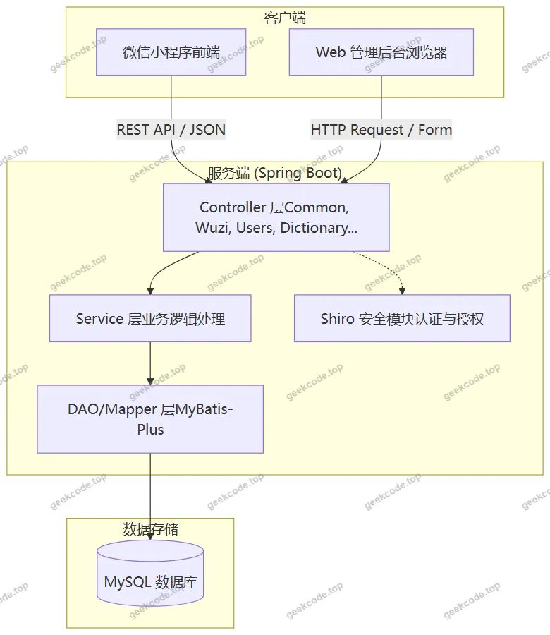</a>

<h2>功能模块</h2>

根据后台路由 <code>/huanyuan</code>, <code>/beifen</code>, <code>/users</code>, <code>/dictionary...</code>, <code>/wuzi...</code> 以及截图展示的功能，系统主要划分为以下模块：

<h3>1. 小程序用户端</h3>

面向小区居民，提供便捷的物资服务入口：

<ul>
<li><strong>账户体系</strong>:</li>
<li><strong>注册/登录</strong>: 支持手机号或账号密码注册登录。</li>
<li><strong>个人中心</strong>: 查看和修改个人信息 (<code>userinfo</code>)，修改密码 (<code>changepassword</code>)，忘记密码找回。</li>
<li><strong>物资服务</strong>:</li>
<li><strong>物资浏览</strong>: 首页展示推荐物资，进入“物资”列表页查看所有可用防疫物资详情。</li>
<li><strong>物资申请</strong>: 用户可对紧缺物资发起预约申请，并在“物资申请列表”中查看申请状态。</li>
<li><strong>物资捐赠</strong>: 用户可登记捐赠物资，并在“物资捐赠列表”中查看历史记录。</li>
<li><strong>物资收藏</strong>: 将感兴趣的物资加入“物资收藏列表”，方便后续查找。</li>
<li><strong>互动留言</strong>: 对特定物资或平台提出建议，生成“物资留言列表”。</li>
<li><strong>资讯获取</strong>:</li>
<li><strong>通知公告</strong>: 查看“通知公告列表”，获取疫情动态、物资发放通知等重要信息。</li>
</ul>
<h3>2. Web 后台管理端</h3>

面向物业管理员，提供全面的数据管理与系统配置功能：

<ul>
<li><strong>系统管理</strong>:</li>
<li><strong>登录与安全</strong>: 管理员登录 (<code>admin</code>)，包含换源 (<code>/huanyuan</code>) 和备份 (<code>/beifen</code>) 等运维辅助功能。</li>
<li><strong>配置中心</strong>: 管理系统全局配置文件 (<code>/config</code>)。</li>
<li><strong>用户管理</strong>: 维护管理员账号 (<code>/users</code>) 及普通注册用户信息 (<code>/yonghu</code>)。</li>
<li><strong>业务数据管理</strong>:</li>
<li><strong>物资管理</strong>: 增删改查物资基础信息 (<code>/wuzi</code>)，监控物资库存变动 (<code>/wuziChuruInout</code>, <code>/wuziChuruInoutList</code>)。</li>
<li><strong>流程审批</strong>: 处理用户的物资捐赠申请 (<code>/wuziJuanzeng</code>) 和物资预约申请 (<code>/wuziYuyue</code>)，审核结果同步至前端。</li>
<li><strong>互动管理</strong>: 查看和管理用户对物资的留言 (<code>/wuziLiuyan</code>) 以及收藏记录 (<code>/wuziCollection</code>)。</li>
<li><strong>内容发布</strong>:</li>
<li><strong>通知公告</strong>: 发布和管理新闻公告 (<code>/news</code>) 及论坛帖子 (<code>/forum</code>)，确保信息及时传达。</li>
<li><strong>字典管理</strong>:</li>
<li>维护系统运行所需的基础数据字典，包括论坛状态、新闻分类、性别、物资类型、出入库类型、收藏状态、捐赠审核状态、预约审核状态等 (<code>/dictionary...</code>)，保证业务逻辑的规范性。</li>
</ul>
<h2>用户角色与权限</h2>

系统主要包含两类角色：<strong>管理员 (Admin)</strong> 和 <strong>普通用户 (User/Yonghu)</strong>。

<h3>1. 管理员 (Admin)</h3>
<ul>
<li><strong>访问终端</strong>: Web 后台管理界面。</li>
<li><strong>权限范围</strong>:</li>
<li><strong>超级权限</strong>: 拥有系统所有功能的读写权限。</li>
<li><strong>数据管理</strong>: 可对物资、用户、公告、论坛内容进行全生命周期管理（创建、编辑、删除、审核）。</li>
<li><strong>流程控制</strong>: 负责审批用户的物资捐赠和预约申请，决定通过与否。</li>
<li><strong>系统配置</strong>: 可修改系统参数、字典表数据，执行数据备份与还原操作。</li>
<li><strong>可见性</strong>: 可查看全量数据，包括所有用户的申请记录、留言和收藏情况。</li>
</ul>
<h3>2. 普通用户 (User)</h3>
<ul>
<li><strong>访问终端</strong>: 微信小程序。</li>
<li><strong>权限范围</strong>:</li>
<li><strong>个人数据</strong>: 仅能查看和管理自己的个人信息、申请记录、捐赠记录、收藏列表和留言历史。</li>
<li><strong>公共数据读取</strong>: 可浏览公开的物资列表、通知公告、论坛帖子。</li>
<li><strong>业务发起</strong>: 有权发起物资预约申请、登记物资捐赠、发表留言、收藏物资。</li>
<li><strong>受限操作</strong>: 无法直接修改物资库存数据，无法发布官方公告，无法审核他人申请，无权访问后台管理路由。</li>
</ul>
<h2>项目特色与创新点</h2>
<ol>
<li><strong>多端协同闭环</strong>: 实现了从移动端（小程序）的需求发起（申请/捐赠）到 PC 端（后台）的管理审批，再反馈至移动端的完整业务闭环，提升了社区防疫物资流转的效率。</li>
<li><strong>精细化字典驱动</strong>: 引入了丰富的字典表体系（如 <code>dictionaryWuzi</code>, <code>dictionaryWuziYuyueYesno</code> 等），使得物资分类、审核状态等业务规则高度可配置，降低了硬编码带来的维护成本，增强了系统的灵活性。</li>
<li><strong>全流程追溯</strong>: 通过 <code>wuziChuruInout</code>（出入库）和 <code>wuziJuanzeng</code>（捐赠）等模块，建立了物资来源与去向的清晰台账，有助于疫情期间物资分配的透明化和合规性审计。</li>
<li><strong>轻量化部署</strong>: 采用 Spring Boot + MyBatis-Plus 组合，配合 Thymeleaf 服务端渲染，既保证了后端的高并发处理能力，又简化了后台管理页面的开发复杂度，适合中小型社区快速部署落地。</li>
</ol>
<h2>部署环境</h2>

为确保系统正常运行，需准备以下软硬件环境：

<strong>1. 软件环境</strong>

<ul>
<li><strong>操作系统</strong>: Windows 10/11 或 Linux (CentOS 7+, Ubuntu 20.04+)。</li>
<li><strong>JDK</strong>: Java Development Kit 1.8 或更高版本（建议 JDK 8 LTS）。</li>
<li><strong>数据库</strong>: MySQL 5.7 或 8.0+，需启用 InnoDB 引擎。</li>
<li><strong>Maven</strong>: Apache Maven 3.6+，用于依赖管理和项目构建。</li>
<li><strong>Node.js</strong>: v12.x 或 v14.x（若涉及前端静态资源编译或工具链支持）。</li>
<li><strong>微信开发者工具</strong>: 最新稳定版，用于小程序代码的运行、调试与预览。</li>
</ul>

<strong>2. 硬件环境</strong>

<ul>
<li><strong>CPU</strong>: Intel Core i5 或同等性能处理器以上。</li>
<li><strong>内存</strong>: 至少 8GB RAM（建议 16GB 以保证开发体验和服务稳定性）。</li>
<li><strong>硬盘</strong>: SSD 固态硬盘，预留至少 20GB 空间用于数据库文件和日志存储。</li>
</ul>

<strong>3. 网络环境</strong>

<ul>
<li>服务器需具备公网 IP 或内网穿透能力，以便微信小程序前端能够访问后端 API 接口。</li>
<li>域名需完成 ICP 备案并配置 HTTPS 证书（微信小程序强制要求 HTTPS）。</li>
</ul>
<h2>五、技术特性</h2>
<ul>
<li>前后端集成部署，前端资源打包至后端 static 目录</li>
<li>使用 MyBatis-Plus 简化数据访问层开发</li>
<li>集成 Shiro 权限框架实现角色权限控制</li>
</ul>
<h2>六、功能模块截图</h2>
<h3>微信小程序用户端</h3>

<figure><figcaption>小程序-登录</figcaption></figure>
<figure><figcaption>小程序-个人信息userinfo</figcaption></figure>
<figure><a href="https://geekcode.top/archives/%E5%B0%8F%E5%8C%BA%E7%89%A9%E4%B8%9A%E6%96%B0%E5%86%A0%E7%96%AB%E6%83%85%E7%89%A9%E8%B5%84%E7%AE%A1%E7%90%86%E5%B9%B3%E5%8F%B0%E5%B0%8F%E7%A8%8B%E5%BA%8F-%E8%AE%BA%E6%96%87pf?utm_source=github" title="查看完整源码">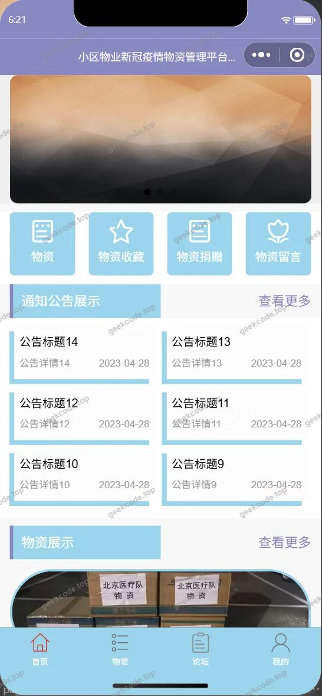</a><figcaption>小程序-首页</figcaption></figure>
<figure><a href="https://geekcode.top/archives/%E5%B0%8F%E5%8C%BA%E7%89%A9%E4%B8%9A%E6%96%B0%E5%86%A0%E7%96%AB%E6%83%85%E7%89%A9%E8%B5%84%E7%AE%A1%E7%90%86%E5%B9%B3%E5%8F%B0%E5%B0%8F%E7%A8%8B%E5%BA%8F-%E8%AE%BA%E6%96%87pf?utm_source=github" title="查看完整源码">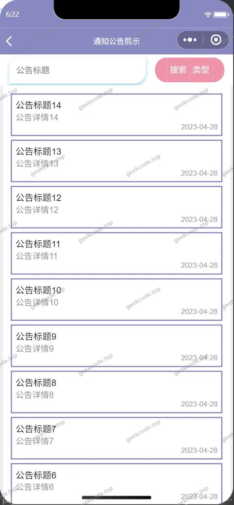</a><figcaption>小程序-通知公告列表</figcaption></figure>
<figure><figcaption>小程序-忘记密码</figcaption></figure>
<figure><a href="https://geekcode.top/archives/%E5%B0%8F%E5%8C%BA%E7%89%A9%E4%B8%9A%E6%96%B0%E5%86%A0%E7%96%AB%E6%83%85%E7%89%A9%E8%B5%84%E7%AE%A1%E7%90%86%E5%B9%B3%E5%8F%B0%E5%B0%8F%E7%A8%8B%E5%BA%8F-%E8%AE%BA%E6%96%87pf?utm_source=github" title="查看完整源码">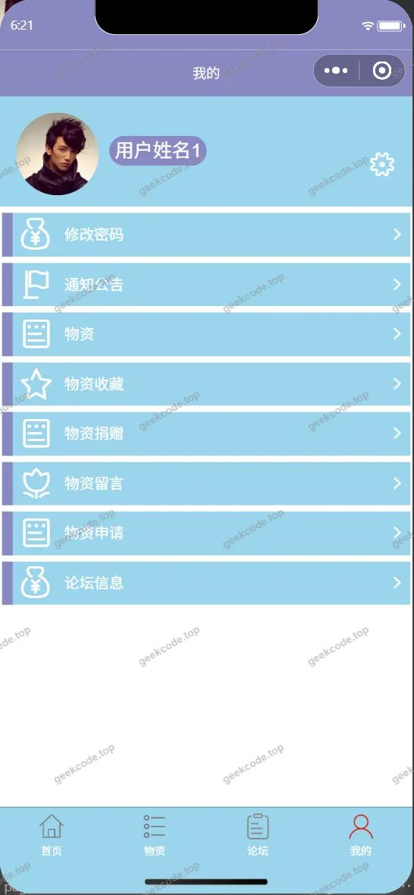</a><figcaption>小程序-我的</figcaption></figure>
<figure><a href="https://geekcode.top/archives/%E5%B0%8F%E5%8C%BA%E7%89%A9%E4%B8%9A%E6%96%B0%E5%86%A0%E7%96%AB%E6%83%85%E7%89%A9%E8%B5%84%E7%AE%A1%E7%90%86%E5%B9%B3%E5%8F%B0%E5%B0%8F%E7%A8%8B%E5%BA%8F-%E8%AE%BA%E6%96%87pf?utm_source=github" title="查看完整源码">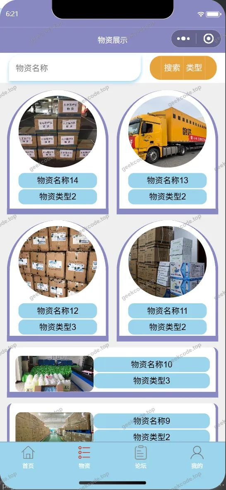</a><figcaption>小程序-物资</figcaption></figure>
<figure><a href="https://geekcode.top/archives/%E5%B0%8F%E5%8C%BA%E7%89%A9%E4%B8%9A%E6%96%B0%E5%86%A0%E7%96%AB%E6%83%85%E7%89%A9%E8%B5%84%E7%AE%A1%E7%90%86%E5%B9%B3%E5%8F%B0%E5%B0%8F%E7%A8%8B%E5%BA%8F-%E8%AE%BA%E6%96%87pf?utm_source=github" title="查看完整源码">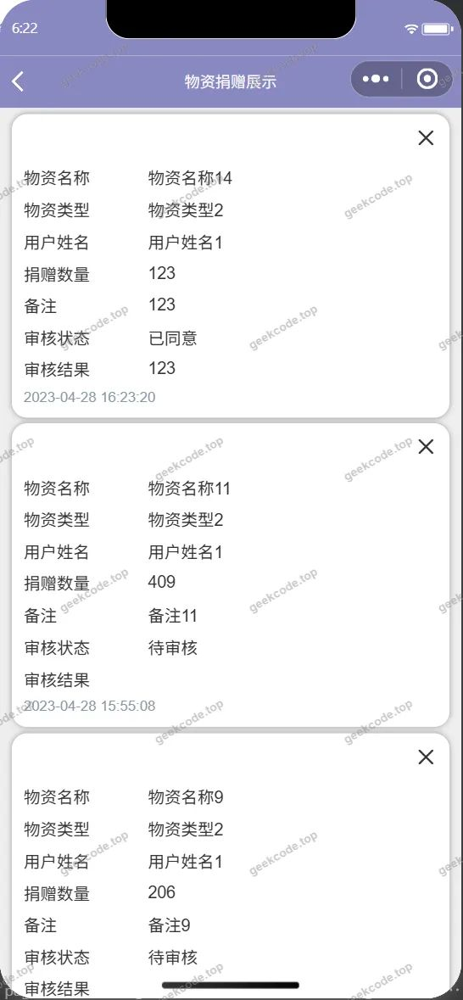</a><figcaption>小程序-物资捐赠列表</figcaption></figure>
<figure><a href="https://geekcode.top/archives/%E5%B0%8F%E5%8C%BA%E7%89%A9%E4%B8%9A%E6%96%B0%E5%86%A0%E7%96%AB%E6%83%85%E7%89%A9%E8%B5%84%E7%AE%A1%E7%90%86%E5%B9%B3%E5%8F%B0%E5%B0%8F%E7%A8%8B%E5%BA%8F-%E8%AE%BA%E6%96%87pf?utm_source=github" title="查看完整源码">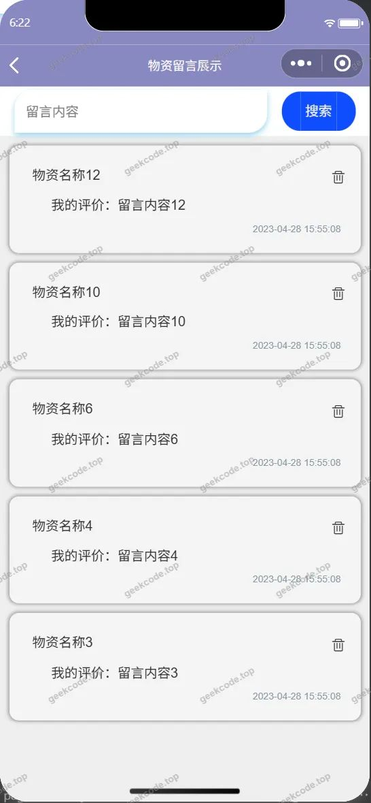</a><figcaption>小程序-物资留言列表</figcaption></figure>
<figure><a href="https://geekcode.top/archives/%E5%B0%8F%E5%8C%BA%E7%89%A9%E4%B8%9A%E6%96%B0%E5%86%A0%E7%96%AB%E6%83%85%E7%89%A9%E8%B5%84%E7%AE%A1%E7%90%86%E5%B9%B3%E5%8F%B0%E5%B0%8F%E7%A8%8B%E5%BA%8F-%E8%AE%BA%E6%96%87pf?utm_source=github" title="查看完整源码">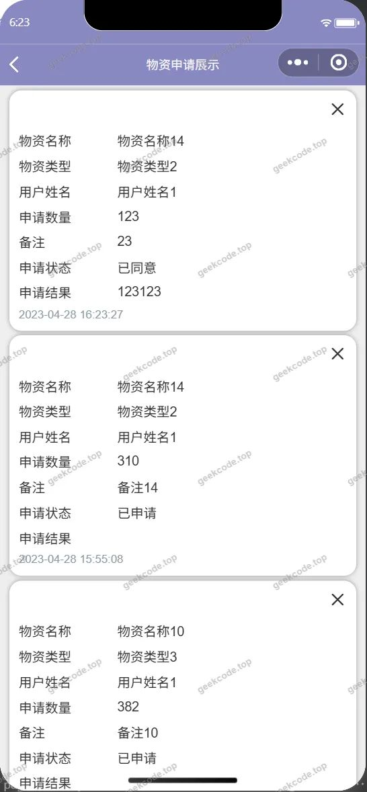</a><figcaption>小程序-物资申请列表</figcaption></figure>
<figure><figcaption>小程序-物资收藏列表</figcaption></figure>
<figure><a href="https://geekcode.top/archives/%E5%B0%8F%E5%8C%BA%E7%89%A9%E4%B8%9A%E6%96%B0%E5%86%A0%E7%96%AB%E6%83%85%E7%89%A9%E8%B5%84%E7%AE%A1%E7%90%86%E5%B9%B3%E5%8F%B0%E5%B0%8F%E7%A8%8B%E5%BA%8F-%E8%AE%BA%E6%96%87pf?utm_source=github" title="查看完整源码">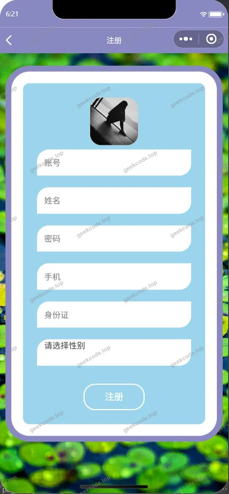</a><figcaption>小程序-注册</figcaption></figure>
<figure><figcaption>小程序-changepassword</figcaption></figure>

<h3>后台管理端</h3>
<h4>后台-登录页</h4>

<h4>后台-管理员</h4>

<a href="https://geekcode.top/archives/%E5%B0%8F%E5%8C%BA%E7%89%A9%E4%B8%9A%E6%96%B0%E5%86%A0%E7%96%AB%E6%83%85%E7%89%A9%E8%B5%84%E7%AE%A1%E7%90%86%E5%B9%B3%E5%8F%B0%E5%B0%8F%E7%A8%8B%E5%BA%8F-%E8%AE%BA%E6%96%87pf?utm_source=github" title="查看完整源码">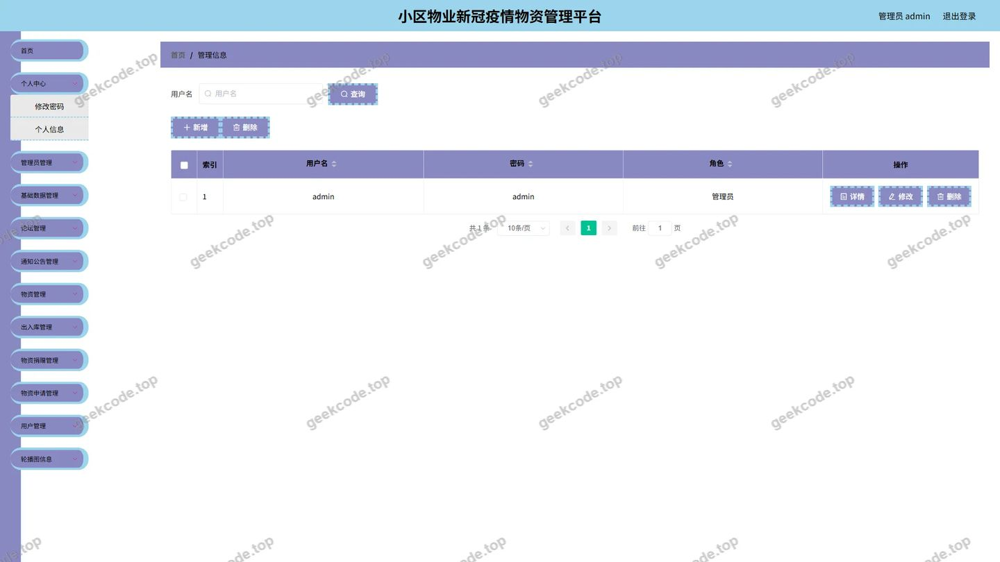</a>

<h4>后台-配置文件</h4>

<a href="https://geekcode.top/archives/%E5%B0%8F%E5%8C%BA%E7%89%A9%E4%B8%9A%E6%96%B0%E5%86%A0%E7%96%AB%E6%83%85%E7%89%A9%E8%B5%84%E7%AE%A1%E7%90%86%E5%B9%B3%E5%8F%B0%E5%B0%8F%E7%A8%8B%E5%BA%8F-%E8%AE%BA%E6%96%87pf?utm_source=github" title="查看完整源码">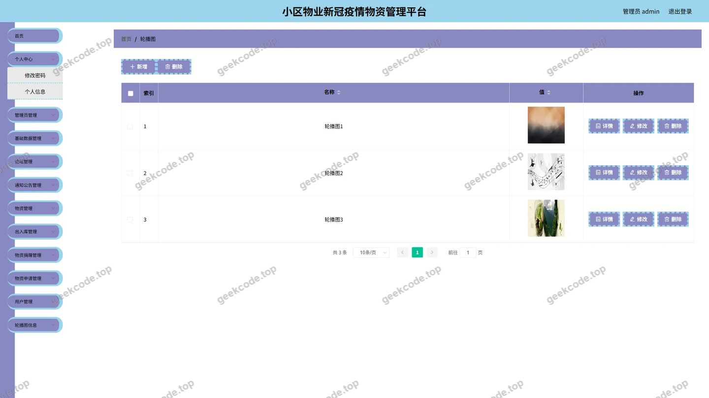</a>

<h4>后台首页</h4>

<a href="https://geekcode.top/archives/%E5%B0%8F%E5%8C%BA%E7%89%A9%E4%B8%9A%E6%96%B0%E5%86%A0%E7%96%AB%E6%83%85%E7%89%A9%E8%B5%84%E7%AE%A1%E7%90%86%E5%B9%B3%E5%8F%B0%E5%B0%8F%E7%A8%8B%E5%BA%8F-%E8%AE%BA%E6%96%87pf?utm_source=github" title="查看完整源码">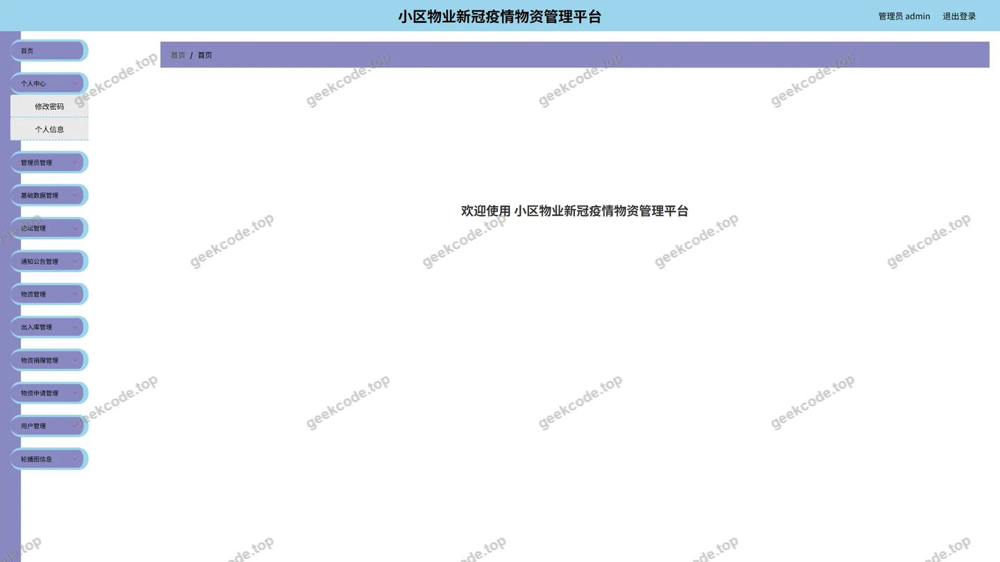</a>

<h4>后台-通知公告</h4>

<a href="https://geekcode.top/archives/%E5%B0%8F%E5%8C%BA%E7%89%A9%E4%B8%9A%E6%96%B0%E5%86%A0%E7%96%AB%E6%83%85%E7%89%A9%E8%B5%84%E7%AE%A1%E7%90%86%E5%B9%B3%E5%8F%B0%E5%B0%8F%E7%A8%8B%E5%BA%8F-%E8%AE%BA%E6%96%87pf?utm_source=github" title="查看完整源码">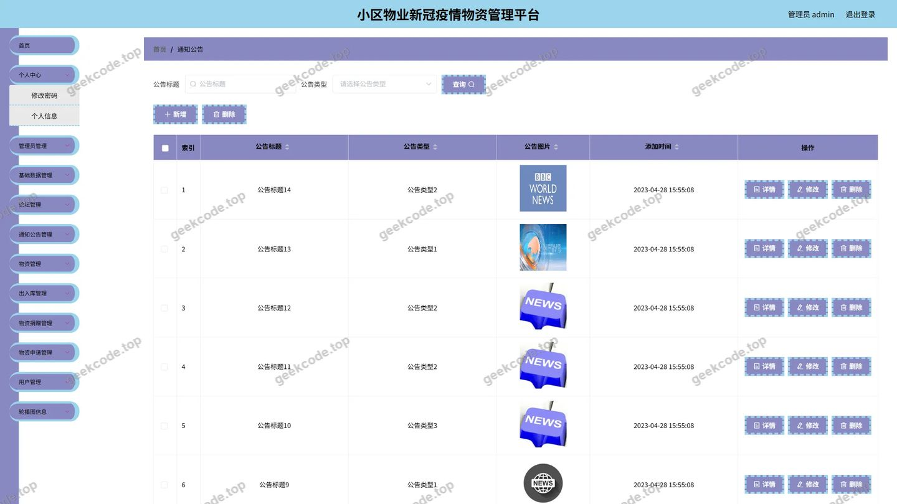</a>

<h4>后台-物资</h4>

<a href="https://geekcode.top/archives/%E5%B0%8F%E5%8C%BA%E7%89%A9%E4%B8%9A%E6%96%B0%E5%86%A0%E7%96%AB%E6%83%85%E7%89%A9%E8%B5%84%E7%AE%A1%E7%90%86%E5%B9%B3%E5%8F%B0%E5%B0%8F%E7%A8%8B%E5%BA%8F-%E8%AE%BA%E6%96%87pf?utm_source=github" title="查看完整源码">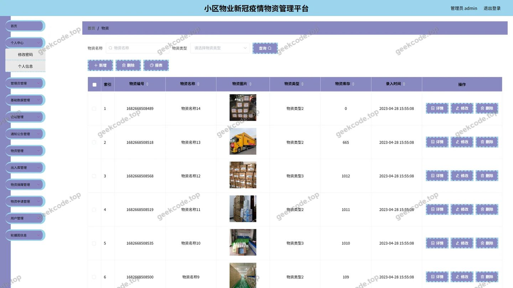</a>

<h4>后台-用户</h4>

<a href="https://geekcode.top/archives/%E5%B0%8F%E5%8C%BA%E7%89%A9%E4%B8%9A%E6%96%B0%E5%86%A0%E7%96%AB%E6%83%85%E7%89%A9%E8%B5%84%E7%AE%A1%E7%90%86%E5%B9%B3%E5%8F%B0%E5%B0%8F%E7%A8%8B%E5%BA%8F-%E8%AE%BA%E6%96%87pf?utm_source=github" title="查看完整源码">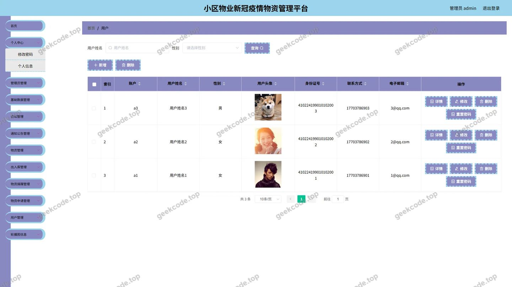</a>

---

## 获取完整源码

| 项目 | 说明 |
| --- | --- |
| 项目名 | 小区物业新冠疫情物资管理平台小程序--论文pf |
| 运行截图 | 本文 21 张（站点带水印原图，仓库 `images/` 目录） |
| 完整源码 | [https://geekcode.top/archives/%E5%B0%8F%E5%8C%BA%E7%89%A9%E4%B8%9A%E6%96%B0%E5%86%A0%E7%96%AB%E6%83%85%E7%89%A9%E8%B5%84%E7%AE%A1%E7%90%86%E5%B9%B3%E5%8F%B0%E5%B0%8F%E7%A8%8B%E5%BA%8F-%E8%AE%BA%E6%96%87pf?utm_source=github](https://geekcode.top/archives/%E5%B0%8F%E5%8C%BA%E7%89%A9%E4%B8%9A%E6%96%B0%E5%86%A0%E7%96%AB%E6%83%85%E7%89%A9%E8%B5%84%E7%AE%A1%E7%90%86%E5%B9%B3%E5%8F%B0%E5%B0%8F%E7%A8%8B%E5%BA%8F-%E8%AE%BA%E6%96%87pf?utm_source=github) |
| 咨询微信 | **ir9372**（备注：jingpin-yuanma） |
| 更多项目 | [极客代码 geekcode.top](https://geekcode.top/?utm_source=github) |

> 需要源码、部署、改配置、跑不起来等问题，加微信 ir9372 沟通，说明项目名即可。
